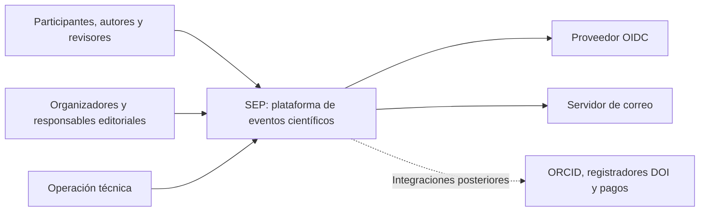
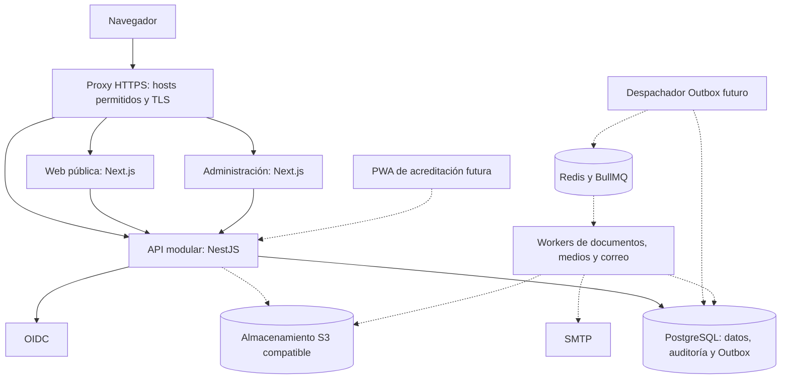

# Arquitectura de referencia

Estado: arquitectura de referencia con API mínima NestJS y módulos de identidad/eventos implementados. Frontends, workers e integraciones siguen pendientes. La resolución de plataforma está en el guard de contexto y en una función SQL restringida; no existe todavía un módulo administrativo completo de plataforma.

## C4: contexto

Los diagramas usan Mermaid para representar los niveles de contexto y contenedores de C4.

El proveedor OIDC autentica; SEP decide permisos. Los servicios externos son adaptadores sustituibles. Integraciones posteriores no forman parte de Fase 0.

## C4: contenedores

Las líneas discontinuas señalan capacidades posteriores al incremento mínimo. La web pública y administrativa se construyen en Fase 1. En Fase 0 se priorizan API, PostgreSQL, autorización y evidencia de aislamiento. Los workers usarán servicios de aplicación y contratos de sus módulos; su acceso a PostgreSQL conservará contexto, autorización e idempotencia.

## Propiedad de módulos

| Módulo | Responsabilidad | Primera etapa |
|---|---|---|
| `platform` | Organizaciones, registro de dominios y aprovisionamiento. | Fase 0 |
| `identity` | Personas, identidades externas, afiliaciones, membresías y asignaciones. | Fase 0 |
| `events` | Series, ediciones, eventos, configuración y estado de publicación. | Fase 0 |
| `science`, `submissions`, `peer-review` | Estructura científica, expedientes, versiones, evaluación y decisiones. | Fase 2 |
| `program` | Sesiones, salas, presentaciones y conflictos. | Fase 2 |
| `registration`, `badges`, `certificates` | Inscripciones, derechos, acreditación y emisión verificable. | Fase 3 |
| `posters`, `proceedings` | Activos científicos públicos y flujo editorial. | Fase 3 |
| `communication`, `analytics` | Mensajes e indicadores autorizados. | Fase 3 |
| `payments`, `logistics`, `integrations` | Adaptadores y servicios complementarios. | Fases posteriores |

Autorización y auditoría son capacidades transversales internas, con interfaces explícitas. El resolvedor de contexto usa el registro de dominios de `platform`; `identity` devuelve asignaciones y datos mínimos del principal; el servicio de aplicación del módulo propietario autoriza cada operación. Los repositorios reciben el contexto validado, no la petición HTTP sin procesar.

## Dependencias y transacciones

El núcleo de políticas recibe atributos y permisos, sin depender de repositorios de negocio. Cada módulo consume interfaces públicas de otros módulos; una interacción bidireccional se resuelve mediante orquestación o eventos, no con imports circulares.

Una operación atómica escribe sus datos, auditoría relevante y Outbox en la misma transacción cuando corresponda. El envío a una cola no se realiza como sustituto de esa escritura transaccional. El consumidor acepta posibles duplicados y aplica idempotencia.

Las primeras migraciones seguirán el [modelo mínimo](modelo-dominio.md). Los módulos futuros no implican crear anticipadamente sus tablas o servicios.

Referencias: [ADR-001](../adr/ADR-001-arquitectura.md), [ADR-002](../adr/ADR-002-tenancy.md).
