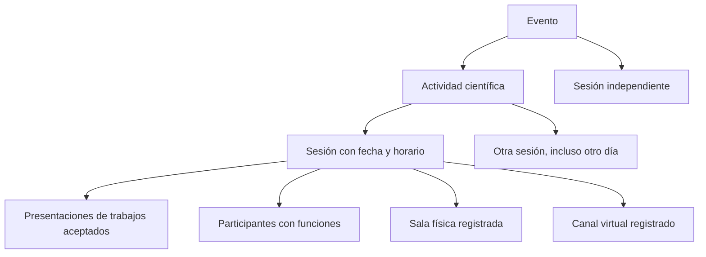

# Estudio comparativo de la organización científica de eventos

Fecha de consulta: 17 de octubre de 2026. Alcance: comparación internacional y multidisciplinar de documentación oficial de asociaciones y congresos. Es una muestra de prácticas, no una taxonomía mundial exhaustiva ni una norma universal. Las definiciones operativas de SEP que siguen son decisiones de producto derivadas de esa comparación.

## Hallazgo principal

El primer programa de SEP representaba todo como sesiones con ponencias. Eso impide representar bien un simposio con varios bloques, un taller sin artículos, una mesa redonda con panelistas o una sesión de pósteres simultáneos. La estructura científica, el formato de una sesión, el formato de una presentación y su modalidad de participación son ejes independientes.

La palabra simposio puede nombrar un evento completo, una actividad temática dentro de un congreso o un bloque. Taller puede referirse a una actividad con varias sesiones o a un único bloque práctico. Mesa redonda tampoco tiene exactamente la misma dinámica en todas las comunidades. SEP debe permitir estas combinaciones sin obligar a todas las disciplinas a usar la misma jerarquía.

## Comparación de fuentes primarias

| Asociación o congreso | Práctica observada | Consecuencia para SEP |
|---|---|---|
| ACM CHI 2026, interacción persona-ordenador | El taller se propone con objetivos, responsables y actividades; puede ocupar uno o dos bloques. No equivale necesariamente a una sucesión de artículos. | Actividad científica y sesión deben ser objetos distintos; un taller puede contener varias sesiones. |
| ISA, Congreso Mundial de Sociología en Corea | Distingue sesiones abiertas, invitadas, pósteres, mesas redondas y conjuntas. Su mesa redonda puede organizar varios grupos de discusión simultáneos, mientras un panel invitado sigue otra dinámica. | Los nombres no bastan para inferir reglas universales. Se necesita tipo de sesión y participantes con funciones, además de autores de trabajos. |
| ANPOCS 2026, Brasil | Organiza grupos de trabajo, simposios, paneles virtuales, mesas redondas y otras actividades. Su descripción de los encuentros muestra grupos de trabajo repartidos en varias sesiones y días. | Se requiere una actividad estable a la que se vinculen sesiones independientes en el calendario. |
| AGU26, comunidad internacional de geociencias | Ofrece sesiones orales, pósteres, GeoBurst, plenarias, talleres y town halls. Las opciones online pueden implicar material grabado y conversación asíncrona, no participación en directo. | Virtual no significa automáticamente videoconferencia en vivo. El formato y la participación presencial/virtual deben almacenarse por separado; soporte de grabaciones y asincronía requiere un desarrollo propio. |
| EGU, Asamblea General | Su programa distingue sesiones científicas, simposios de la Unión, grandes debates y cursos cortos. | El programa no se reduce a trabajos aceptados ni a un único formato de actividad. |
| AMEE 2026, educación médica internacional | Su programa combina simposios, talleres, comunicaciones, ePosters y PechaKucha. | El formato final de presentación no debe confundirse con el tipo de documento recibido o el área temática. |
| APS, comunidad de física | Distingue presentaciones orales, pósteres y formatos breves combinados, además de experiencias presenciales y virtuales. | Una contribución, su formato de presentación y su modalidad deben poder representarse de forma independiente. Las presentaciones de póster no siguen necesariamente una secuencia individual de horarios. |

Fuentes oficiales utilizadas:

- [ACM CHI 2026: Workshops](https://chi2026.acm.org/workshops/).
- [ISA: Conference format](https://www.isa-sociology.org/isa-events/xxi-world-congress-of-sociology/congress-guidelines/conference-format).
- [ANPOCS 2026: Mesas redondas](https://www.encontro2026.anpocs.org.br/conteudo/view?ID_CONTEUDO=773) y [organización de los encuentros](https://anpocs.org.br/encontros-anuais/).
- [AGU26: Session formats](https://www.agu.org/annual-meeting/Schedule?tab=session-formats).
- [EGU26: Programme groups](https://www.egu26.eu/pg-selection-s).
- [AMEE 2026: Programme overview](https://amee.org/events/amee-2026/programme/overview/).
- [APS: Contributed abstracts](https://summit.aps.org/attend/abstracts/contributed/). Esta página se actualiza por edición; en la consulta incluía reglas para 2027. Se usa para identificar conceptos y no para imponer esas reglas o duraciones a SEP.

## Modelo operativo propuesto e implementado

El vínculo de una sesión con una actividad es opcional: una plenaria o una mesa redonda breve no necesitan un contenedor artificial. Un simposio que se celebra como evento completo se configura como evento; si forma parte de un congreso, puede ser una actividad científica de ese evento. En este bloque no se crean eventos anidados con dominios, inscripciones o permisos propios.

**Actividad científica:** tiene identificador, tipo, nombre, descripción y coordinación científica. No ocupa una sala por sí misma: sus sesiones concretas reservan los espacios. Puede agrupar sesiones con formatos diferentes. Se muestran como actividades científicas para evitar confundirlas con las organizaciones/entidades institucionales que administran SEP.

**Sesión:** es un bloque de calendario con tipo, actividad opcional, fecha, horario, modalidad, espacios y participantes. Puede incluir trabajos o tener un contenido propio, como una conferencia o debate. La coordinación de la actividad y la moderación de la sesión son funciones diferentes.

**Presentación:** es la aparición programada de un trabajo aceptado, con autor presentador, versión oficial, formato, participación presencial/virtual, horario e identificación de póster cuando procede. No cambia el tipo de contribución, el documento ni el dictamen científico.

**Espacio:** tiene identificador y código estable, nombre, tipo físico/virtual, ubicación, capacidad opcional y estado. Las sesiones seleccionan referencias; no vuelven a escribir el nombre de la sala. Una sesión híbrida reserva una sala física y un canal virtual. Un espacio virtual es una reserva de infraestructura, no la creación de una reunión Zoom, Teams o similar.

## Catálogo inicial

| Nivel | Opciones iniciales |
|---|---|
| Actividad científica | Simposio, taller, mesa redonda, panel, debate, foro, seminario, coloquio, curso, eje/programa temático, otra actividad |
| Tipo de sesión | Presentación de trabajos, pósteres, panel, mesa redonda, debate, taller práctico, curso/tutorial, conferencia magistral, plenaria, seminario, foro, actividad especial |
| Formato de presentación | Ponencia oral, comunicación breve, póster, póster electrónico, demostración, vídeo, PechaKucha, comunicación para debate, otro formato |
| Función científica | Coordinador de actividad, moderador, conferencista, panelista, debatiente, facilitador, presentador de trabajo |

Los códigos del catálogo son estables y sus etiquetas bilingües. No se anuncian como clasificación oficial internacional. Las opciones «otra actividad» y «actividad especial» evitan forzar clasificaciones; un catálogo personalizado por evento sigue siendo una ampliación. No se imponen tiempos universales a formatos como PechaKucha o comunicación breve.

## Reglas que corrigen el primer programa

- Una sesión de ponencias o pósteres requiere trabajos para publicarse. Una mesa redonda, taller, curso, conferencia u otro tipo puede publicarse sin trabajo, si tiene descripción y participantes responsables.
- Los pósteres pueden compartir el mismo intervalo dentro de una sesión. Una sesión de intervenciones orales sigue exigiendo que no se solapen. La identificación de cada póster no puede repetirse dentro de la sesión.
- La modalidad de la sesión y la participación del presentador son independientes: una sesión híbrida admite presentadores presenciales y remotos. Una sesión exclusivamente presencial o virtual exige participantes presentadores compatibles con esa modalidad.
- Los conflictos se verifican por IDs de espacios y por personas vinculadas. No se deduce que dos nombres parecidos sean la misma persona.
- Una coordinación científica no concede permisos de organizador ni de decisión editorial. La programación tampoco acredita asistencia ni genera certificados.

## Ejemplos

1. Congreso → Simposio de Ciencia Abierta → sesión de ponencias por la mañana y sesión de pósteres por la tarde. Cada sesión tiene sus salas, moderadores y presentaciones.
2. Congreso → Taller de análisis de datos → dos sesiones prácticas con facilitadores, sin necesidad de crear artículos ficticios.
3. Congreso → mesa redonda independiente → moderador, panelistas y debatientes, descripción del asunto y horario; los trabajos son opcionales.
4. Congreso → sesión híbrida de ponencias → reserva de auditorio y canal virtual; una ponencia presencial y otra presentada a distancia.

## Ampliaciones que esta investigación identifica pero no simula

Convocatorias y evaluación de propuestas de actividades; comités o permisos delegados por simposio; inscripción/cupo/pago por taller; paneles con mesas simultáneas dentro de una sala; demostraciones con puestos paralelos; participación grabada/asíncrona y sus ventanas de disponibilidad; presentaciones múltiples del mismo trabajo; varios copresentadores; idiomas e interpretación por sesión; equipamiento e indisponibilidades de salas; reuniones y enlaces de acceso con privacidad; confirmación del invitado; control de asistencia y certificación.

Estos conceptos deben incorporarse a sus módulos correspondientes. En particular, añadir «vídeo» como formato no proporciona alojamiento, streaming ni asistencia asíncrona, y gestionar una sala no comprueba por sí solo el aforo real.
