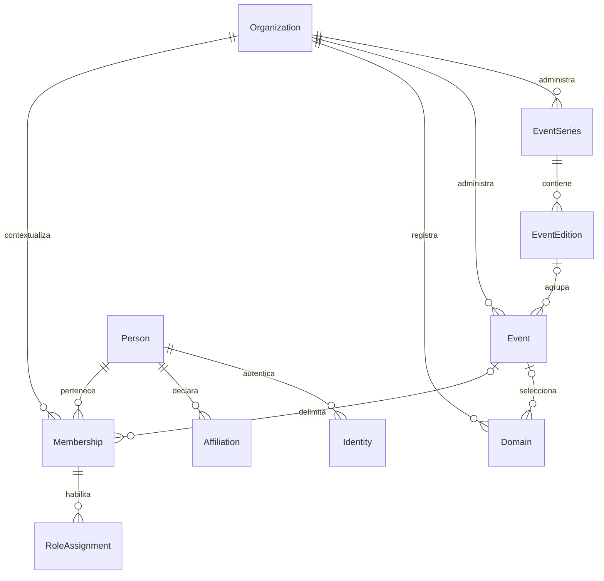

# Modelo inicial de dominio

Estado: propuesta para Fase 0; no es un esquema de base de datos implementado.

## Jerarquía y vocabulario

| Concepto | Significado propuesto |
|---|---|
| `Organization` | Institución responsable y límite tenant. Una organización organiza muchas series y eventos. |
| `EventSeries` | Continuidad histórica de un encuentro, por ejemplo Congreso de Biotecnología. |
| `EventEdition` | Ocurrencia de una serie, por ejemplo edición 2027; agrupa eventos de esa edición. |
| `Event` | Unidad operativa con configuración, dominio, roles y procesos propios. |
| Actividad dependiente | Taller, simposio o sesión dentro de un evento; inicialmente pertenece a su mismo ámbito. |

Propuesta: una serie tiene cero o más ediciones; una edición pertenece a una sola serie y tiene cero o más eventos durante su preparación. Un evento pertenece a una organización y puede no tener edición si es independiente. Si tiene edición, organización, edición y serie deben coincidir. No se crea una serie artificial para cada evento independiente.

Una edición no recibe dominios ni roles de evento en Fase 0. Sus datos son históricos y de agrupación. Una actividad que necesite aislamiento y administración propios se representará como otro `Event`; las relaciones padre/hijo y su navegación quedan pendientes de refinamiento. No se implementará herencia de permisos.

Estas cardinalidades afinan la jerarquía orientativa del proyecto técnico. Deben validarse con el piloto antes de fijar migraciones; especialmente si una edición necesita más de un evento o si existen organizaciones coorganizadoras.

## Relaciones

El diagrama representa cardinalidades conceptuales. Las restricciones de ámbito que siguen son obligatorias aunque no aparezcan en el dibujo.

## Entidades mínimas y restricciones

| Entidad | Datos principales | Restricciones propuestas |
|---|---|---|
| Organization | ID, nombre, estado. | ID inmutable; suspensión bloquea operaciones privadas ordinarias. |
| EventSeries | ID, organización, nombre localizado. | Propietaria única. |
| EventEdition | ID, organización, serie, etiqueta. | Referencia compuesta a serie; etiqueta única dentro de serie. |
| Event | ID, organización, edición opcional, nombre localizado, fechas, zona horaria, estado. | Edición de la misma organización; fecha final posterior a inicial si ambas están definidas. |
| Domain | ID, organización, evento opcional, hostname, estado de verificación, principal/alias. | Hostname normalizado único en la plataforma; evento de la misma organización; solo activo y verificado resuelve contexto. |
| Person | ID, nombre, preferencias de idioma, estado. | Identidad global privada; nombre o correo no demuestran unicidad. |
| Identity | ID, persona, emisor, sujeto, estado. | Par `(issuer, subject)` único; no enlazar cuentas automáticamente por correo. |
| Affiliation | ID, persona, institución declarada, período. | Una institución declarada no equivale a pertenecer a un tenant ni concede rol. |
| Membership | ID, persona, organización, evento opcional, estado. | Ámbito explícito organización o evento; un solo registro por persona/ámbito, con historial de cambios. |
| RoleAssignment | ID, membresía, código de rol, vigencia, estado. | Rol compatible con ámbito; evitar duplicados activos; vencimiento y revocación comprobados en servidor. |

Un dominio con evento nulo representa el portal de organización. El host de administración técnica pertenece a configuración de plataforma separada y no a un tenant ficticio. La activación real exige prueba de control de dominio; los fixtures usan dominios de prueba sin tocar DNS público. Verificación y vigencia TLS son controles distintos.

Las fechas operativas se almacenarán como instantes y el evento conservará una zona horaria IANA. Las traducciones usarán claves de idioma y un idioma por defecto habilitado; el fallback será idioma solicitado, idioma por defecto del evento y español para mensajes del sistema. El contenido científico original no exige traducción automática.

## Pertenencia y delegación

La membresía expresa una relación contextual, no una inscripción ni una lista pública de asistentes. La membresía de organización no crea membresías de evento. Una persona puede tener simultáneamente membresía de organización y de varios eventos.

Un organizador puede gestionar membresías y delegar roles operativos permitidos en su evento. No puede otorgar roles de plataforma u organización. El administrador de organización puede designar organizadores de sus eventos sin recibir sus permisos científicos. La lista de roles delegables será explícita y se aplicará en servidor.

El superadmin técnico se asigna en un registro de plataforma separado; nunca mediante una membresía tenant con organización nula. Una API ordinaria de evento no puede crear esa asignación.

## Perfil global y proyecciones

La persona consulta y modifica sus datos globales. Un operador ve únicamente los datos mínimos necesarios de personas vinculadas al evento y para la acción autorizada. No ve sus otros eventos, identidades externas, consentimientos privados ni afiliaciones no compartidas.

Un coautor invitado puede existir sin cuenta. En fases posteriores, una autoría conservará los datos bibliográficos de la versión publicada; editar el perfil global no reescribe una publicación histórica. El mecanismo de conciliación de duplicados y la base de tratamiento de datos deberán concretarse antes del piloto.

## Conceptos posteriores independientes

| Concepto | Separación obligatoria |
|---|---|
| Contribución / Submission | Expediente científico del evento, con versiones; no es una persona ni una inscripción. |
| Autoría / Authorship | Relación ordenada con una contribución y sus afiliaciones; no exige rol de participante. |
| Inscripción / Registration | Participación operativa por categoría y modalidad; no equivale a pago. |
| Derecho / Entitlement | Permiso de acceso o servicio; no se deduce de un QR válido por sí solo. |
| Credencial / Credential | Identificador verificable de acreditación, con sustitución y revocación. |
| Certificado / Certificate | Constancia emitida según condiciones y evidencia, con revocación. |
| Publicación / Publication | Resultado editorial autorizado; aceptación científica no implica publicación. |

Estas entidades no se crearán en las primeras migraciones.

## Integridad y trazabilidad

Los registros de evento llevan organización y evento; sus relaciones usan claves compuestas para impedir cruces. La desactivación no borra silenciosamente historial. Cambios de pertenencia, permisos, dominios y publicación se auditan con actor, contexto, acción, recurso, instante y resultado, sin volcar tokens ni datos científicos privados.

No se permite cambiar una organización propietaria mediante una actualización ordinaria. Traslado, eliminación definitiva y retención necesitan procedimientos explícitos pendientes de definición. El modelo de auditoría y Outbox se detallará antes de las operaciones que los necesiten.

Referencias: [tenancy](../adr/ADR-002-tenancy.md), [permisos](../functional/matriz-permisos.md).
