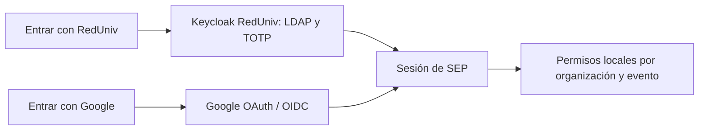

# Dos accesos independientes: RedUniv y Google directo

Estado: ambos flujos implementados en SEP y pendientes de credenciales, activación y validación funcional. La propuesta anterior de Google mediante Keycloak queda retirada por indicación del propietario. No se ha modificado cursos-enlinea, Keycloak ni Google Cloud.

## Referencia revisada

De cursos-enlinea se leyeron `src/lib/google-oauth.ts`, `src/app/api/auth/google/start/route.ts` y `src/app/api/auth/google/callback/route.ts`. Allí se usa Authorization Code con PKCE S256 y state, scopes openid/email/profile, consulta de UserInfo, correo verificado y sesión propia de la aplicación.

SEP reproduce ese acceso directo con sus propios componentes y almacenamiento: añade validación OIDC de ID token/nonce y mantiene identidad por `(issuer, sub)`. No copia los secretos, sesiones, tablas o el enlace automático por correo de cursos-enlinea. Vincular ambas cuentas conservando historial requerirá una operación explícita posterior; no se fusionan silenciosamente.

Las personas externas usan Google sin tener cuenta RedUniv ni LDAP. La activación de Google no necesita habilitar un proveedor social o usuarios externos en el realm institucional. Google autentica la persona; no concede automáticamente pertenencias, inscripciones ni roles funcionales.

## Qué solicitar a Identidad

> Necesitamos registrar SEP con acceso institucional directo al realm reduniv-institucional. Solicitamos clientes confidenciales separados sep-admin-dev, sep-admin-test y sep-admin-prod; Authorization Code con PKCE S256; scopes openid/profile/email/roles; audience de API sep-api; roles generales de cliente ROLE_USER y ROLE_ADMIN. Registrar callbacks /api/auth/callback, retornos /es y /en, y Web Origins exactos por ambiente. El callback local actual es http://127.0.0.1:6789/api/auth/callback. Los orígenes HTTPS de pruebas y producción quedan por confirmar.
>
> Emitir sub, exp, iat, name o preferred_username, email y email_verified, además de la audience y roles correspondientes al cliente. LDAP, TOTP y recuperación siguen administrados en Identidad. Entregar el client ID y el secreto mediante el canal seguro correspondiente; el secreto se configura únicamente en el servidor de SEP. No se necesitan cambios para Google dentro de Keycloak: SEP lo integrará directamente.

La [solicitud de cliente RedUniv](solicitud-cliente-reduniv.md) detalla responsables y URLs. ROLE_ADMIN en Keycloak permite acceso general; la administración de organizaciones/eventos sigue siendo explícita en SEP.

## Qué configurar en Google Cloud

1. Preparar un proyecto y credenciales propios para SEP bajo el equipo responsable. No reutilizar el secreto o cliente de cursos-enlinea.
2. Configurar audiencia External para permitir personas ajenas a la organización. Completar nombre, contactos, dominios y páginas de privacidad/términos que correspondan, y solicitar solo openid, email y profile.
3. Crear un cliente OAuth de tipo Web application por ambiente.
4. Registrar como Authorized redirect URI el origen de SEP más `/api/auth/google/callback`. Para el desarrollo actual: `http://127.0.0.1:6789/api/auth/google/callback`. Para producción usar el origen HTTPS real.
5. Configurar el Google Client ID y Client Secret en el servidor de SEP, mediante un archivo local privado o gestor de secretos. No enviarlos a Keycloak ni incorporarlos al repositorio/chat.
6. Completar la publicación/configuración de acceso público conforme a las políticas y estado del proyecto Google antes de abrirlo a usuarios internacionales.

| Proveedor | Callback local actual | Credenciales almacenadas en |
|---|---|---|
| RedUniv | http://127.0.0.1:6789/api/auth/callback | Servidor de SEP |
| Google | http://127.0.0.1:6789/api/auth/google/callback | Servidor de SEP |

El puerto corresponde a la demo conservada. Si cambia el origen de la aplicación, actualizar los registros de ambos proveedores antes de conectar las cuentas reales. En Google no se registra el callback `/broker/google/endpoint` de Keycloak para este diseño.

## Configuración de SEP

La [.env.oidc.example](../../.env.oidc.example) reúne la configuración. Se usa `AUTH_MODE=oidc` en la API y `SEP_AUTH_MODE=oidc` en la web como modo de acceso real, con `SEP_DEMO_MODE=0`. El almacenamiento de sesiones requiere origen, directorio privado y clave de cifrado comunes. Las credenciales de proveedor son independientes:

| RedUniv | Google |
|---|---|
| OIDC_ISSUER / OIDC_JWKS_URL | GOOGLE_CLIENT_ID |
| OIDC_CLIENT_ID / OIDC_CLIENT_SECRET | GOOGLE_CLIENT_SECRET |
| OIDC_AUDIENCE / OIDC_AUTHORIZED_PARTY | GOOGLE_API_AUDIENCE |
| OIDC_ROLE_CLIENT_ID / OIDC_ALLOWED_CLIENT_ROLES | GOOGLE_SESSION_SIGNING_KEY |

Para habilitar Google configurar `SEP_GOOGLE_LOGIN_ENABLED=1` y sus credenciales. El servidor web necesita el client ID/secret y una clave independiente de 32 bytes en hexadecimal para las credenciales internas; la API necesita el mismo client ID, audience y clave de firma. Esta clave no es el secreto OAuth de Google ni la clave de cifrado del almacén.

El acceso Google no depende del secreto ni de la disponibilidad de Keycloak. La API conserva la configuración pública de RedUniv para aceptar sus tokens cuando se active esa opción. En el acceso real aparecen ambos botones; cada uno queda deshabilitado si su configuración está incompleta. No se admiten aliases de broker enviados por el navegador.

## Sesiones y autorización

Los flujos usan cookies de transacción separadas, de diez minutos, con state, nonce y PKCE. El callback Google valida el ID token y consulta UserInfo para exigir sub consistente y correo verificado. Después descarta los tokens OAuth Google y conserva únicamente una sesión propia de SEP, cifrada, de un máximo absoluto de ocho horas. No se solicita offline_access ni acceso a Drive, Calendar u otras APIs.

El navegador recibe solo un identificador opaco HttpOnly/SameSite. El gateway emite credenciales internas `sep_google.` firmadas HS256, de hasta cinco minutos, con issuer/audience propios y el client ID configurado. Nunca envía un Google access token a la API de SEP como si fuera un token RedUniv. La API comprueba la credencial, resuelve la identidad estable `https://accounts.google.com + sub` y consulta los permisos actuales en PostgreSQL. No se incorporan roles administrativos a esa credencial.

Las invitaciones exigen correo verificado coincidente tanto para Google como para RedUniv. Una identidad nueva se crea sin roles ni pertenencias automáticas. Desactivar una persona o su identidad bloquea el acceso en la siguiente petición.

Cerrar una sesión Google elimina la sesión local; no cierra la cuenta global de Google. Las credenciales internas ya emitidas pueden durar hasta cinco minutos después de cerrar sesión. Cambios o revocaciones en Google se comprueban al volver a autenticar; no se consulta continuamente Google durante la sesión propia de ocho horas. Esta política es distinta de RedUniv, que conserva renovación y logout central según la guía institucional.

Faltan configuración real de clientes, secretos, orígenes compartidos/productivos y validación de extremo a extremo, pospuesta por solicitud del propietario. Google cubre personas con cuenta Google; admitir personas sin Google o RedUniv requerirá otro método posterior. El enlace explícito de identidades y la conservación de una sola persona entre proveedores también quedan pendientes.

Referencias: [OIDC de Google](https://developers.google.com/identity/openid-connect), [OAuth web de Google](https://developers.google.com/identity/protocols/oauth2/web-server), [openid-client](https://github.com/panva/openid-client).
