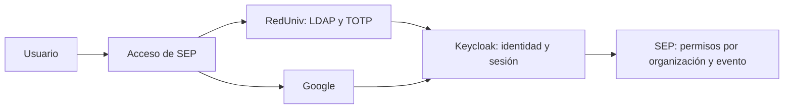

# Acceso institucional e internacional: RedUniv y Google

Estado: opción Google vía broker preparada en SEP; activación externa y pruebas pendientes. No se ha configurado Google Cloud ni modificado Keycloak.

## Revisión de cursos-enlinea

Se revisaron `src/lib/google-oauth.ts`, `src/app/api/auth/google/start/route.ts` y `src/app/api/auth/google/callback/route.ts` del proyecto local `cursos-enlinea`. Allí Google se conecta directamente a la aplicación mediante Authorization Code, state, PKCE S256 y los scopes openid/email/profile. El callback consulta UserInfo, exige correo verificado y crea una sesión propia.

Ese proyecto enlaza automáticamente una cuenta local existente por coincidencia de correo en el primer acceso Google. SEP mantendrá `(issuer, sub)` y exigirá verificación explícita de las cuentas para vincularlas, preservando permisos e historial. No se han modificado archivos de cursos-enlinea ni leído sus secretos.

## Integración propuesta

RedUniv y Google se ofrecen como opciones; Keycloak emite los tokens que consume SEP en ambos casos.



Esta propuesta aprovecha el OIDC ya implementado y mantiene una sola política de sesiones, renovación, audiencia y autorización para SEP. Google no exige que la persona tenga cuenta LDAP ni se convierta en miembro institucional.

Identidad debe confirmar si el realm `reduniv-institucional` admite personas externas. Habilitar un proveedor social en un realm compartido exige revisar sus efectos sobre los demás clientes y grupos. No se deben conceder automáticamente permisos de otros sistemas a las personas externas.

Si la política institucional impide externos en ese realm, solicitar un realm público independiente para SEP en el mismo servicio de identidad. Ese realm puede usar Google y RedUniv como proveedores federados. En ese caso cambia el issuer/JWKS de SEP al nuevo realm y se configura un alias de broker para RedUniv. No se instalará automáticamente otro servidor ni se incluirán extranjeros en LDAP para resolver esta necesidad.

## Mensaje para el equipo de Identidad

> Necesitamos incorporar la Plataforma de Eventos Científicos (SEP) con acceso institucional e internacional. Solicitamos clientes OIDC confidenciales separados: sep-admin-dev, sep-admin-test y sep-admin-prod, con Authorization Code y PKCE S256. SEP usa callback /api/auth/callback, retornos de logout /es y /en, scopes openid/profile/email/roles, audience sep-api y los roles generales de cliente ROLE_USER y ROLE_ADMIN. Adjuntamos las URLs exactas y la solicitud de cliente del repositorio.
>
> Además de RedUniv, necesitamos acceso mediante Google para personas sin cuenta LDAP. Por favor, confirmar si se permiten usuarios externos en reduniv-institucional. Si se permiten, configurar Google como Identity Provider y comunicar su alias y Redirect URI exacto. Si se mantiene exclusivo de usuarios institucionales, proponemos un realm público separado para SEP con Google y RedUniv como proveedores federados.
>
> El primer acceso Google debe permitir crear una identidad externa en Keycloak, sin crear cuentas LDAP y sin conceder permisos en otras aplicaciones. Definir una asignación de ROLE_USER específica del cliente SEP para esas personas, nunca ROLE_ADMIN automáticamente. Mantener los permisos funcionales dentro de SEP y emitir email/email_verified respetando la verificación real, porque SEP exige correo verificado para aceptar invitaciones. Configurar una vinculación de cuentas con comprobación de identidad, sin fusiones silenciosas por coincidencia de correo. Confirmar también la política TOTP para externos y administradores.
>
> Entregar el secreto del cliente SEP y configurar el secreto Google únicamente por canales seguros. Necesitamos los client IDs, issuer, alias del proveedor Google y URLs de retorno aprobadas. No enviar secretos por correo, chat o repositorio.

La [solicitud de cliente](solicitud-cliente-reduniv.md) contiene los campos de ambientes, responsables y URLs por completar. El origen local actual es `http://127.0.0.1:6789`; los orígenes compartidos y productivos deben definirse con HTTPS.

## Pasos para Google Cloud

1. Preparar un proyecto OAuth administrado por el equipo responsable de Identidad/SEP, con credenciales separadas de cursos-enlinea.
2. Configurar la audiencia External, nombre, contactos, dominios y las páginas de privacidad/términos correspondientes. Usar solo openid, email y profile para esta integración.
3. Crear un cliente OAuth de tipo Web application.
4. Registrar como Authorized redirect URI el valor que muestra el proveedor Google en Keycloak. Si el alias es `google` y se usa el realm institucional, el valor esperado es `https://identidad.reduniv.edu.cu/realms/reduniv-institucional/broker/google/endpoint`. Copiar el valor real del administrador de Keycloak; cambia con el realm o alias.
5. Entregar Google Client ID y Client Secret a Identidad por canal seguro para configurar el broker. Esas credenciales se guardan en Keycloak, no en SEP. Revisar/publicar la configuración para acceso público de acuerdo con el estado y políticas vigentes de Google.
6. Dejar vacío Hosted Domain en el proveedor Google de Keycloak si se admite cualquier cuenta Google autorizada. Una restricción a un dominio excluiría a usuarios internacionales de otros dominios.

## Credenciales y callbacks distintos

| Conexión | Credenciales guardadas en | Callback registrado |
|---|---|---|
| SEP → Keycloak | Servidor privado de SEP | Origen SEP + /api/auth/callback |
| Keycloak → Google | Keycloak | Issuer del realm + /broker/alias/endpoint |

El callback directo de cursos-enlinea `/api/auth/google/callback` no se reutiliza para el broker de SEP. No se copian sus secretos, tokens ni sesiones. Google autentica la cuenta; la pertenencia a un evento, la inscripción y los permisos siguen siendo conceptos separados.

## Activación en SEP

La opción se mantiene deshabilitada hasta que Identidad complete y apruebe el broker. Después configurar:

```text
SEP_GOOGLE_LOGIN_ENABLED=1
SEP_GOOGLE_IDP_ALIAS=google
```

Usar el alias real comunicado por Identidad. El botón envía únicamente una selección RedUniv/Google; el backend obtiene el alias de su configuración y añade `kc_idp_hint`. Los dos caminos mantienen PKCE, state, nonce y el callback OIDC existente, incluidos los enlaces de invitación.

Si se utiliza el realm institucional directamente, `SEP_REDUNIV_IDP_ALIAS` permanece vacío. Si se adopta un realm público con RedUniv federado, configurar ese alias, el nuevo issuer y su JWKS. El cierre central finaliza la sesión Keycloak y la de SEP; no cierra globalmente la cuenta Google del navegador.

No se ha implementado Google directo en SEP. Si Identidad no puede ofrecer un broker público, esa alternativa requerirá ampliar el modelo de proveedores, callbacks y sesiones y mantener dos autoridades de identidad. La experiencia de cursos-enlinea sirve como referencia, sin copiar su vinculación automática por correo.

Google cubre cuentas personales y cuentas de organizaciones que lo permitan. Para admitir también a personas sin cuenta Google o RedUniv habría que añadir otro proveedor o un mecanismo de registro y verificación de correo, con su propia política.

Referencias: [Google en Keycloak](https://www.keycloak.org/docs/latest/server_admin/#_google), [sugerencia de proveedor](https://www.keycloak.org/docs/latest/server_admin/#client-suggested-identity-provider), [OAuth web de Google](https://developers.google.com/identity/protocols/oauth2/web-server), [preparación para producción](https://developers.google.com/identity/protocols/oauth2/production-readiness/overview).
