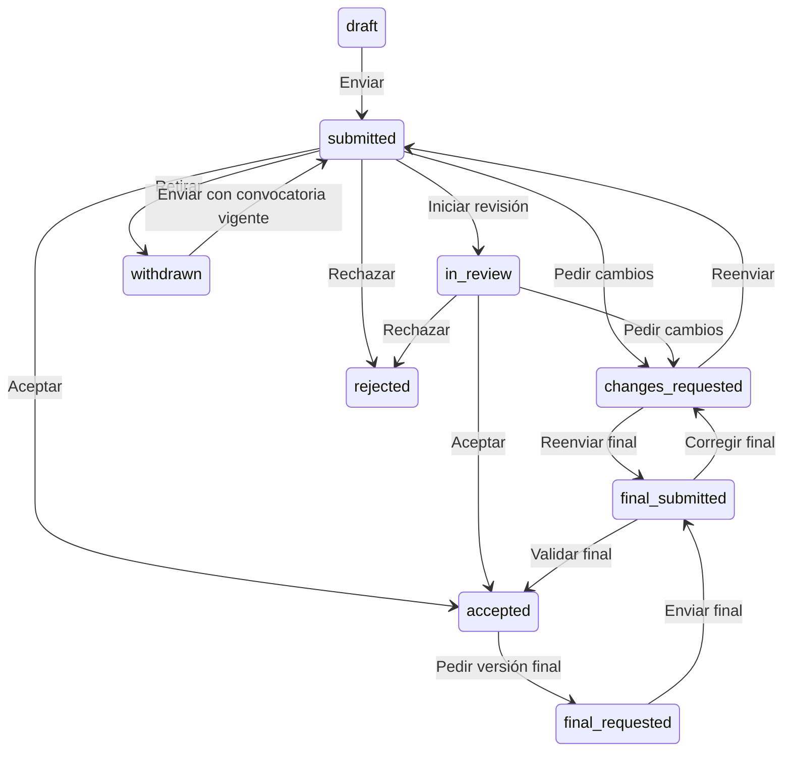

# Módulo de trabajos

Implementado en español e inglés. Autor y organizador utilizan las mismas APIs privadas y permisos por evento. No requiere que un autor pertenezca a RedUniv ni a la organización.

## Recorrido del autor

1. Abrir **Mis trabajos**, crear un borrador y completar título, resumen, palabras clave y autoría desde **Editar**. Guardar vuelve a consulta; **Cerrar** cierra el panel. Si hay cambios pendientes, ofrece guardar, descartar o seguir editando.
2. Seleccionar el manuscrito PDF en **Editar** y pulsar **Guardar cambios** para adjuntarlo. También se puede reemplazar o preparar su retirada. El tipo indica si es obligatorio y su máximo de páginas. En consulta se descarga el PDF y la demo advierte si no se ha realizado escaneo antivirus.
3. Si cambió la convocatoria, actualizar explícitamente sus reglas y revisar área/tipo y requisitos. Preparar antes de apertura está permitido; enviar exige plazo vigente.
4. Confirmar y pulsar enviar. El trabajo queda bloqueado para edición y aparece su primera versión en el historial. Guardar o adjuntar por separado no constituye envío.
5. Si el organizador pide cambios, editar y reenviar dentro del plazo indicado. Mientras se prepara la respuesta, la organización conserva acceso únicamente a la última versión enviada.
6. Tras aceptación, responder a una solicitud de versión final. Se conservan idioma, área y tipo aceptados. Cada reenvío crea otra versión; las anteriores se pueden consultar y descargar.
7. Retirar requiere motivo y conserva el historial. Quitar del listado se permite únicamente para borradores que nunca se enviaron y conserva el registro de auditoría.

## Recorrido del organizador

Abrir **Trabajos recibidos** en el evento donde se tenga asignación de organizador. Filtrar por estado o título, recorrer páginas y abrir un trabajo. Se muestran su contenido formal, versiones, PDF e historial comunicado.

Pulsar **Gestionar estado o dictamen**, elegir la acción y escribir el mensaje al autor. Solicitar correcciones o versión final exige fecha límite. Se puede aceptar o rechazar desde recepción/revisión y revisar la versión final recibida. Una cuenta no puede decidir sobre su propio trabajo. Un administrador institucional necesita también la asignación de organizador del evento.

Estos controles registran decisiones del organizador. La evaluación por revisores y la publicación de trabajos aceptados se implementan por separado. No se envían notificaciones por correo en este incremento.

El diagrama resume las rutas principales; también se admite retirar desde revisión, correcciones, aceptación o fase final. Rechazo es terminal. Las operaciones exigen revisión vigente para evitar sobrescrituras.

## API

Prefijo `/api/v1/events/:eventId`. El propietario y ámbito se resuelven en servidor. Véase [OpenAPI](../api/openapi.json).

| Ruta | Métodos y operación |
|---|---|
| `/my-works` | GET espacio propio; POST crear |
| `/my-works/:id` | GET detalle; PUT guardar; DELETE quitar borrador nunca enviado |
| `/my-works/:id/submit` | POST envío confirmado con revision |
| `/my-works/:id/synchronize-call` | POST actualización explícita de reglas |
| `/my-works/:id/withdraw` | POST retiro con motivo |
| `/my-works/:id/manuscript` | POST multipart file y revision; DELETE desvincular |
| `/my-works/:id/versions/:versionId` | GET instantánea formal |
| `/my-works/:id/files/:fileId` | GET descarga privada |
| `/submissions` | GET listado paginado del organizador, status y q opcionales |
| `/submissions/:id` | GET última versión formal |
| `/submissions/:id/decision` | POST decisión, mensaje, revision y plazo si corresponde |
| `/submissions/:id/versions/:versionId` | GET versión formal autorizada |
| `/submissions/:id/files/:fileId` | GET PDF formal autorizado |

## Operación y verificación

Aplicar migraciones hasta 0027. Para acceso real configurar `CLAMAV_HOST` y opcionalmente `CLAMAV_PORT` (3310 por defecto) con ClamD INSTREAM disponible desde la API y firmas actualizadas. Sin escáner operativo se rechaza la carga y no se habilita el uso de archivos marcados como demo. La configuración externa de antivirus y RedUniv/Google continúa pendiente. La demo local puede recorrerse sin esos proveedores.

Pasaron compilación completa y análisis estático. Una comprobación dirigida con el rol runtime y autorización real verificó PDF obligatorio, privacidad de borradores y correcciones, cuatro versiones, corrección después del cierre, aceptación, versión final con conservación del idioma, retiro y eliminación lógica. Se revirtió la transacción completa para conservar los datos de la demo. Se comprobó rechazo sin antivirus en modo real. Esto no sustituye pruebas funcionales completas, validación por navegador ni integración con un ClamAV real; siguen aplazadas por indicación del propietario.

La comprobación HTTP verificó bandeja autorizada, rechazo de una cuenta sin permisos, pantallas de autor/organizador en ambos idiomas, portal público y transporte multipart hasta la comprobación de propiedad sin modificar trabajos. También se rechazó un PDF con acción activa anidada y se verificó el protocolo INSTREAM con respuestas limpia/infectada de un servidor simulado; no equivale a probar un antivirus real.

Los siguientes bloques científicos son comités y revisión por pares, programa y publicación/memorias. El envío de trabajos y su seguimiento ya están implementados.

## Presentación del seguimiento

El seguimiento destaca el estado actual y un próximo paso según el estado y la edición autorizada por la API. En los estados editables, el autor tiene un acceso directo a Editar trabajo; el envío mantiene su confirmación explícita. El organizador recibe instrucciones propias y no controles de envío del autor.

Un resumen muestra la última versión oficial enviada y la fecha límite de respuesta. Las fechas límite se presentan como fechas de calendario del evento, evitando desplazarlas al día anterior por conversión UTC. Las horas de actividad y envío usan la zona horaria de la convocatoria.

El último mensaje de decisión del equipo se destaca con su fecha y remitente. El PDF actual, las versiones oficiales y el historial se muestran en bloques independientes. Las versiones se ordenan por número descendente; cada una conserva la consulta de su copia inmutable. El historial muestra inicialmente las seis acciones más recientes y permite desplegarlo completo; no elimina ni filtra acciones de autoría o gestión compartida.

El retiro se encuentra en un apartado desplegable independiente. Conserva los permisos existentes, motivo obligatorio y confirmación. La presentación no modifica estados, plazos, permisos o la lógica del envío y no introduce fases de revisión que no estén registradas.

## Dictamen visible durante las correcciones

El detalle y el editor mantienen a la vista el mensaje del equipo y los comentarios publicados de los revisores. Mis trabajos identifica las novedades pendientes por persona, con contador en el menú y acceso directo al dictamen. La lectura persiste en servidor y no altera la revisión del borrador ni produce cambios sin guardar.

El editor agrupa datos del trabajo, resumen/palabras clave, autores/afiliaciones y documento PDF. Cada autor dispone de una tarjeta con orden de firma, nombre/ORCID, correspondencia/contacto y afiliaciones. Las acciones de vinculación de cuenta se encuentran en un desplegable independiente; los campos requeridos permanecen visibles. Se conservan búsqueda de personas, validaciones, permisos y guardado explícito. Los controles compartidos igualan altura y alineación de campos de texto y selectores de país, también en el perfil.

Se comprobó en navegador el trabajo real con dos comentarios publicados, consulta y edición, avisos, cancelación con cambios, español/inglés y ausencia de desbordamiento a 390/320 píxeles. Las escrituras y lecturas de avisos de la comprobación visual se interceptaron; los trabajos, informes y avisos reales quedaron intactos. La persistencia, lecturas parciales, aislamiento y protección frente a mensajes nuevos se verificaron con servicios reales en una transacción revertida.

## Consulta, edición y envío explícito

Mis trabajos presenta directamente el listado, sin repetir el encabezado de la página. La fila seleccionada se identifica con un borde sin sombreado. El detalle y el editor empiezan con el título del trabajo y el modo actual; el título usa la misma familia tipográfica del espacio del participante.

El dictamen y los comentarios de revisión se encuentran dentro de Seguimiento del trabajo, después del contenido consultado o del editor. Se mantienen los avisos y su lectura persistente. Consultar un trabajo no muestra la confirmación de autoría ni un formulario de envío.

Desde Editar, Guardar cambios mantiene abierto el editor. Revisar y enviar versión N se habilita sobre datos guardados; abre una confirmación independiente con título, número de versión y PDF que se enviará. La confirmación de autoría y el envío solo aparecen allí. Un error conserva el diálogo y permite corregir o cancelar. El envío exitoso vuelve a consulta y conserva una copia oficial.

`submissionReady` indica si hay correcciones guardadas respecto al contenido enviado. Para correcciones solicitadas, la API rechaza un reenvío sin diferencias científicas con `WORK_UNCHANGED`; incrementar la revisión del borrador o actualizar confirmaciones de identidad no basta. Las diferencias pueden ser en datos, resumen, palabras clave, autoría o documento: no es obligatorio sustituir el PDF si solo corresponde corregir otros datos. La primera entrega, la versión final solicitada y la reactivación de un retiro conservan sus reglas anteriores.

El editor de autorías reúne nombre, correo y ORCID en una fila adaptable; correspondencia y orden se gestionan en la cabecera, afiliaciones en filas compactas y las acciones de identidad en un desplegable. Institución y país mantienen controles de igual altura. Los campos obligatorios permanecen visibles.

Verificación dirigida de este ajuste: dos trabajos simulados para comprobar selección/título, ausencia del envío en consulta, revisiones dentro del seguimiento en ambos modos, guardado que conserva el editor, envío con versión/documento explícitos, bloqueo de cambios sin guardar, fuente del título, alineación de controles y móvil de 390/320 píxeles. Las escrituras del navegador se interceptaron. En servicios reales, una transacción revertida comprobó el rechazo de correcciones idénticas, la insuficiencia de incrementar la revisión y la creación de la versión 2 después de guardar una corrección.
